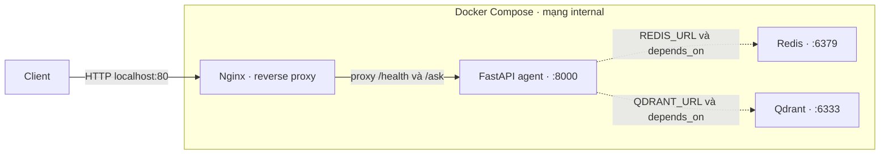

# Day 14 Lab — Mission Answers

## Part 1 — Localhost vs Production

### Exercise 1.1 — Anti-patterns trong bản develop

| # | Vấn đề | Vị trí | Hậu quả khi triển khai |
|---|---|---|---|
| 1 | Hardcode API key và thông tin kết nối database trong mã nguồn. | [`develop/app.py`, dòng 17–18](01-localhost-vs-production/develop/app.py#L17-L18) | Nếu dùng giá trị thật, bất kỳ ai đọc được repo hoặc lịch sử commit đều có thể lấy thông tin xác thực. Muốn đổi key phải sửa mã nguồn và triển khai lại. |
| 2 | Cấu hình nằm trong mã nguồn. `DEBUG` và `MAX_TOKENS` được khai báo bằng giá trị cố định. | [`develop/app.py`, dòng 20–22](01-localhost-vs-production/develop/app.py#L20-L22) | Khó dùng cùng một bản build cho dev, staging và production vì các thiết lập này không thể được điều chỉnh bằng biến môi trường. |
| 3 | Dùng `print()` cho log ứng dụng và in cả giá trị API key. | [`develop/app.py`, dòng 32–38](01-localhost-vs-production/develop/app.py#L32-L38) | Log thiếu trường riêng cho thời gian và mức độ nghiêm trọng nên khó lọc tự động. Nếu debug in key thật, key có thể bị lộ qua hệ thống thu thập log. |
| 4 | Thiếu endpoint kiểm tra trạng thái. App chỉ khai báo hai route `/` và `/ask`. | [`develop/app.py`, dòng 25–43](01-localhost-vs-production/develop/app.py#L25-L43) | Nền tảng triển khai thiếu endpoint chuyên dụng để kiểm tra tiến trình còn sống hay instance đã sẵn sàng nhận request. |
| 5 | Uvicorn bind vào `localhost` và cố định cổng `8000`. | [`develop/app.py`, dòng 47–53](01-localhost-vs-production/develop/app.py#L47-L53) | Proxy bên ngoài container không kết nối được qua địa chỉ loopback. Nếu nền tảng chỉ định cổng khác qua biến `PORT`, app vẫn lắng nghe ở cổng 8000. |

### Exercise 1.2 — Chạy bản develop

Chạy `python app.py` trong thư mục `01-localhost-vs-production/develop` trên Ubuntu WSL. Từ terminal thứ hai, gửi `question` qua query string:

```bash
curl -i -X POST 'http://localhost:8000/ask?question=Hello'
```

Kết quả từ terminal:

```http
HTTP/1.1 200 OK
date: Thu, 26 Nov 2026 07:25:31 GMT
server: uvicorn
content-length: 103
content-type: application/json

{"answer":"Tôi là AI agent được deploy lên cloud. Câu hỏi của bạn đã được nhận."}
```

HTTP 200 và trường `answer` xác nhận endpoint đã xử lý thành công một request trên localhost. Câu trả lời là nội dung của mock LLM.

### Exercise 1.3 — So sánh develop và production

| Tiêu chí | Develop (`develop/app.py`) | Production (`production/app.py` và `config.py`) | Vì sao thay đổi |
|---|---|---|---|
| Config và secrets | Hardcode `OPENAI_API_KEY` và `DATABASE_URL` có mật khẩu. [Dòng 17–18](01-localhost-vs-production/develop/app.py#L17-L18) | Dataclass `Settings` đọc cấu hình qua `os.getenv`, gồm `OPENAI_API_KEY`, `AGENT_API_KEY` và `LLM_MODEL`. [`config.py`](01-localhost-vs-production/production/config.py#L14-L35) | Giữ secret thật bên ngoài mã nguồn và dùng cùng một bản build với cấu hình khác nhau cho từng môi trường. |
| Kiểm tra cấu hình | Thiếu bước kiểm tra cấu hình khi khởi động. | `Settings().validate()` raise `ValueError` nếu `ENVIRONMENT=production` mà thiếu `AGENT_API_KEY`. Thiếu `OPENAI_API_KEY` thì ghi cảnh báo. Agent mẫu gọi mock LLM. [`config.py`](01-localhost-vs-production/production/config.py#L37-L50) · [`app.py`](01-localhost-vs-production/production/app.py#L24-L25) | Phát hiện thiếu cấu hình bắt buộc ngay khi khởi động. |
| Host binding | `host="localhost"` chỉ lắng nghe trên loopback. | `host=settings.host`, mặc định `0.0.0.0`. [`config.py`](01-localhost-vs-production/production/config.py#L17) · [`app.py`](01-localhost-vs-production/production/app.py#L194-L199) | Proxy có thể kết nối tới app qua mạng container. |
| Port | Cố định `port=8000`. | `port=settings.port` đọc từ biến `PORT`, mặc định `8000`. [`config.py`](01-localhost-vs-production/production/config.py#L18) · [`app.py`](01-localhost-vs-production/production/app.py#L194-L199) | App có thể lắng nghe đúng cổng mà nền tảng triển khai chỉ định. |
| Reload và debug | Khai báo `DEBUG=True` và bật `reload=True` trực tiếp trong lệnh chạy Uvicorn. | `reload=settings.debug`, đọc `DEBUG` từ env và mặc định tắt. [`config.py`](01-localhost-vs-production/production/config.py#L19) · [`app.py`](01-localhost-vs-production/production/app.py#L194-L199) | Tránh việc server tự khởi động lại khi file thay đổi trong production và kiểm soát mức chi tiết của log. |
| Logging | Dùng `print()` cho câu hỏi, câu trả lời và giá trị API key. | Dùng `logging` với timestamp, level và message. Sự kiện request và response ghi metadata như `question_length`, `client_ip` và `response_length`. Formatter hiện chèn message đã qua `json.dumps()` vào chuỗi JSON nên một số dòng có thể bị lỗi định dạng JSON. [Formatter](01-localhost-vs-production/production/app.py#L27-L32) · [Sự kiện](01-localhost-vs-production/production/app.py#L110-L122) | Metadata giúp tìm sự kiện theo ngữ cảnh và giảm lộ nội dung request. Log dạng JSON cần encode đúng để hệ thống thu thập phân tích được. |
| Health check | Thiếu endpoint kiểm tra trạng thái chuyên dụng. | `GET /health` công bố trạng thái liveness, uptime, version và timestamp. `GET /ready` trả 503 khi `is_ready=False`. [`app.py`](01-localhost-vs-production/production/app.py#L135-L161) | Liveness giúp hệ thống giám sát kiểm tra process. Readiness giúp load balancer quyết định có chuyển request tới instance hay chưa. |
| Metrics | Thiếu route `/metrics`. | `GET /metrics` trả JSON chứa `uptime_seconds`, `environment` và `version`. [`app.py`](01-localhost-vs-production/production/app.py#L164-L173) | Client có thể đọc thông tin vận hành cơ bản qua HTTP. Muốn Prometheus scrape trực tiếp, endpoint cần xuất dữ liệu theo định dạng Prometheus hoặc OpenMetrics. |
| Input và response | `POST /ask` nhận `question` qua query string và trả `answer`. | Đọc JSON body, trả 422 nếu `question` thiếu hoặc rỗng, và trả thêm `question` cùng `model`. [`app.py`](01-localhost-vs-production/production/app.py#L102-L128) | JSON body dễ mở rộng khi thêm trường và đưa nội dung câu hỏi ra khỏi URL, nơi có thể xuất hiện trong log truy cập. |
| Lifecycle và graceful shutdown | App thiếu startup và shutdown hook riêng. | `lifespan` bật cờ readiness khi startup và hạ cờ khi shutdown. Handler `SIGTERM` trong app ghi log. Khi Uvicorn thực hiện graceful shutdown, server là thành phần chờ request đang xử lý. [Lifespan](01-localhost-vs-production/production/app.py#L39-L74) · [Handler](01-localhost-vs-production/production/app.py#L180-L189) | Khi restart hoặc triển khai phiên bản mới, app có chỗ để dọn tài nguyên và server có thể hoàn tất các request đang xử lý. |
| CORS | Thiếu cấu hình CORS. | `CORSMiddleware` đọc origin từ settings và cho phép `GET` và `POST`. Mặc định `ALLOWED_ORIGINS="*"`. [`config.py`](01-localhost-vs-production/production/config.py#L33-L35) · [`app.py`](01-localhost-vs-production/production/app.py#L76-L82) | Điều khiển trang web thuộc origin nào được trình duyệt cho phép đọc response từ API. Có thể cấu hình danh sách origin phù hợp với từng môi trường. |
| Metadata app | Title cố định là `My Agent` và `GET /` trả một lời chào. | Title và version lấy từ settings. `GET /` trả `app`, `version`, `environment` và `status`. [FastAPI app](01-localhost-vs-production/production/app.py#L70-L74) · [Route gốc](01-localhost-vs-production/production/app.py#L89-L96) | Xác định được phiên bản và môi trường của instance khi debug hoặc kiểm tra rollback. |

## Part 2 — Docker

### Exercise 2.1 — Dockerfile cơ bản

1. **Base image.** Dockerfile dùng `python:3.11` và có một stage. Comment trong file ước tính base image khoảng 1 GB. Kích thước image đã build sẽ được đo ở Exercise 2.3. [Dockerfile, dòng 6–8](02-docker/develop/Dockerfile#L6-L8)
2. **Working directory.** `WORKDIR /app` đặt thư mục làm việc cho `RUN` và cho tiến trình khởi động từ `CMD`. Đích tương đối của `COPY` cũng tính từ `/app`. Ví dụ, `COPY ... .` đưa file vào `/app`, và `python app.py` chạy ở đó. Nguồn của `COPY` tính từ build context. [Dockerfile, dòng 10–30](02-docker/develop/Dockerfile#L10-L30)
3. **Thứ tự copy dependencies và code.** Dockerfile copy `requirements.txt` ở dòng 14, chạy `pip install` ở dòng 17 rồi copy `app.py` ở dòng 20. Khi chỉ sửa `app.py`, Docker có thể dùng lại cache của bước copy requirements và cài dependencies. Bước copy app và các bước phụ thuộc phía sau sẽ được xây lại. Nếu copy app trước khi cài dependencies, một thay đổi trong app có thể làm Docker chạy lại `pip install` dù requirements giữ nguyên. [Dockerfile, dòng 13–20](02-docker/develop/Dockerfile#L13-L20)
4. **`CMD` và `ENTRYPOINT`.** Dockerfile đặt `CMD ["python", "app.py"]`. Bảng dưới mô tả cách ghi đè khi dùng cú pháp exec dạng mảng. [Dockerfile, dòng 29–30](02-docker/develop/Dockerfile#L29-L30)

| | `CMD` | `ENTRYPOINT` |
|---|---|---|
| Vai trò | Đặt lệnh mặc định, hoặc tham số mặc định nếu có `ENTRYPOINT`. | Đặt chương trình chính của container. |
| Thêm đối số sau tên image khi chạy `docker run` | Các đối số thay thế `CMD`. | Nếu image có `ENTRYPOINT`, các đối số được truyền cho chương trình đó. |
| Cách ghi đè | Truyền lệnh hoặc đối số mới sau tên image. | Dùng `docker run --entrypoint ...`. |

Ví dụ, có thể kết hợp `ENTRYPOINT ["python"]` với `CMD ["app.py"]` để chạy app mặc định và cho phép đổi đối số của Python. Với image develop trong lab, `docker run --rm my-agent:develop python --version` thay lệnh mặc định để in phiên bản Python.

**Build context.** Chạy lệnh sau ở gốc repo vì các nguồn `COPY` như `02-docker/develop/requirements.txt` và `utils/mock_llm.py` được tìm từ build context `.`. Tham số `-f` chỉ chọn Dockerfile. [Dockerfile, dòng 13–24](02-docker/develop/Dockerfile#L13-L24)

```bash
docker build -f 02-docker/develop/Dockerfile -t my-agent:develop .
```

### Exercise 2.2 — Build, chạy và kiểm tra container develop

Chạy từ gốc repo:

```bash
docker build -f 02-docker/develop/Dockerfile -t my-agent:develop .
docker run --rm -d --name day14-docker-dev -p 8000:8000 my-agent:develop
curl -i -X POST 'http://localhost:8000/ask?question=What%20is%20Docker%3F'
```

Docker build hoàn thành trong `87.3s` với `12/12` bước và tạo image `my-agent:develop`. Container publish cổng `8000` để nhận request từ máy local.

```http
HTTP/1.1 200 OK
date: Thu, 26 Nov 2026 07:40:38 GMT
server: uvicorn
content-length: 103
content-type: application/json

{"answer":"Container là cách đóng gói app để chạy ở mọi nơi. Build once, run anywhere!"}
```

Kết quả xác nhận agent trả lời qua cổng được Docker publish. Sau khi kiểm tra, container được dừng bằng `docker stop day14-docker-dev`.

Kết quả đo bằng `docker image ls my-agent:develop`:

| Image | Image ID | Disk usage | Content size |
|---|---|---:|---:|
| `my-agent:develop` | `081ba630af02` | 1.67 GB | 426 MB |

### Exercise 2.3 — Build multi-stage và so sánh kích thước

Chạy từ gốc repo:

```bash
docker build -f 02-docker/production/Dockerfile -t my-agent:advanced .
docker images 'my-agent'
```

Image production build thành công trong `106.5s` với `17/17` bước. Docker báo các kích thước sau:

| Image | Image ID | Disk usage | Content size |
|---|---|---:|---:|
| `my-agent:develop` | `081ba630af02` | 1.67 GB | 426 MB |
| `my-agent:advanced` | `62fa86aa8d90` | 240 MB | 57.4 MB |

Tính mức giảm theo công thức `(develop - advanced) / develop × 100%` cho từng cột. Các kết quả là xấp xỉ vì Docker đã làm tròn số hiển thị.

- **Disk usage:** `(1670 - 240) / 1670 × 100% ≈ 85.6%`, quy đổi `1.67 GB ≈ 1670 MB`.
- **Content size:** `(426 - 57.4) / 426 × 100% ≈ 86.5%`.

**Stage builder** dùng `python:3.11-slim`, cài công cụ build của hệ điều hành và cài Python dependencies từ `requirements.txt` vào `/root/.local`. [Dockerfile, dòng 16–29](02-docker/production/Dockerfile#L16-L29)

**Stage runtime** bắt đầu từ một base `python:3.11-slim` mới, copy dependencies đã cài sang `/home/appuser/.local`, rồi copy `main.py` và mock LLM. App chạy bằng user `appuser` và có health check. [Dockerfile, dòng 36–72](02-docker/production/Dockerfile#L36-L72)

Image cuối nhỏ hơn vì base `slim` gọn hơn base `python:3.11` của bản develop, và công cụ build chỉ nằm ở stage builder. Stage runtime mang theo dependencies và các file app cần để chạy.

### Exercise 2.4 — Docker Compose và Nginx

Chạy từ thư mục `02-docker/production`:

```bash
docker compose -p k5-day14-docker up -d --build
docker compose -p k5-day14-docker ps
```

Sơ đồ stack:



Nginx publish cổng ra host và chuyển request vào agent qua mạng Compose. Agent chờ Redis và Qdrant qua health check lúc khởi động. Hai service được cấu hình cho cache và vector search. Trong bài test này, handler `/ask` gọi mock LLM ngay trong app. Các mũi tên nét đứt thể hiện cấu hình và phụ thuộc lúc khởi động. [Compose](02-docker/production/docker-compose.yml#L22-L100) · [Nginx](02-docker/production/nginx/nginx.conf#L14) · [Handler `/ask`](02-docker/production/main.py#L57-L64)

Tóm tắt kết quả `docker compose ps` ngay sau khi bật stack:

| Service | Trạng thái lúc kiểm tra | Cổng |
|---|---|---|
| `agent` | Up, health check đang ở trạng thái `starting` | `8000/tcp` nội bộ |
| `nginx` | Up | Publish `80` và `443` ra host. Hai test dùng HTTP cổng `80`. |
| `redis` | Healthy | `6379/tcp` nội bộ |
| `qdrant` | Healthy | `6333–6334/tcp` nội bộ |

**Health check qua Nginx**

```bash
curl -i http://localhost/health
```

```http
HTTP/1.1 200 OK
Server: nginx
Date: Thu, 26 Nov 2026 07:45:37 GMT
Content-Type: application/json

{"status":"ok","uptime_seconds":5.8,"version":"2.0.0","timestamp":"2026-11-26T07:45:37.915510"}
```

**Gọi agent qua Nginx**

```bash
curl -i -X POST http://localhost/ask \
  -H 'Content-Type: application/json' \
  -d '{"question":"Explain microservices"}'
```

```http
HTTP/1.1 200 OK
Server: nginx
Date: Thu, 26 Nov 2026 07:45:44 GMT
Content-Type: application/json

{"answer":"Agent đang hoạt động tốt! (mock response) Hỏi thêm câu hỏi đi nhé."}
```

Cả hai request trả `200 OK` với header `Server: nginx`, xác nhận đường đi từ cổng HTTP trên host qua Nginx tới agent.

## Part 3 — Cloud Deployment

### Exercise 3.2 — Deploy agent lên Render

Tôi deploy agent Part 6 trong `06-lab-complete/` lên Render bằng Docker và dùng Key Value tương thích Redis ở cùng region Oregon. URL public là [Day 14 Agent](https://k5-l3b-day14-nguyenminhduc-2a202603751.onrender.com). `GET /health` và `GET /ready` đều trả 200. `POST /ask` trả 401 khi thiếu key và 200 khi có key đúng. [Cấu hình và kết quả test](DEPLOYMENT.md)

### So sánh cấu hình Railway và Render

| Hạng mục | Railway TOML của Part 6 | Render YAML mẫu và cấu hình đã dùng |
|---|---|---|
| Cấu trúc | Các mục `[build]` và `[deploy]` đặt cấu hình cho agent. | Blueprint YAML dùng danh sách `services`, khai báo riêng web service và datastore. Tôi tạo hai service qua dashboard. |
| Build và khởi động | `builder = "DOCKERFILE"` và `dockerfilePath = "Dockerfile"`. | Blueprint ví dụ trong Part 3 dùng Python với các lệnh build và start. Agent Part 6 trên Render chọn runtime Docker, đặt Root Directory là `06-lab-complete` và dùng `CMD` trong Dockerfile. |
| Health check và secret | `healthcheckPath = "/health"`. Key đặt trong biến môi trường của service và `REDIS_URL` tham chiếu service Redis. | Tương ứng với `healthCheckPath: /health`. Blueprint có thể yêu cầu nhập secret bằng `sync: false` hoặc sinh key bằng `generateValue: true`. Trên dashboard tôi đặt key và Internal URL của Key Value trong Environment Variables. |

[Railway TOML](06-lab-complete/railway.toml) · [Render YAML mẫu](03-cloud-deployment/render/render.yaml)

### Exercise 3.3 — Đọc pipeline Cloud Run

1. `cloudbuild.yaml` cài dependencies và chạy `pytest` trong container Python 3.11.
2. Sau bước test, Cloud Build build Docker image, gắn tag theo commit SHA và `latest`, rồi push cả hai tag lên registry.
3. Bước deploy dùng image theo commit SHA để cập nhật service Cloud Run ở `asia-southeast1`, truyền cấu hình production và lấy secret từ Secret Manager.
4. `service.yaml` mô tả service theo cách khai báo, gồm giới hạn **1–10 instance**, concurrency **80**, startup probe `/ready` và liveness probe `/health`.

[Cloud Build](03-cloud-deployment/production-cloud-run/cloudbuild.yaml) · [Cloud Run service](03-cloud-deployment/production-cloud-run/service.yaml)

## Part 4 — API Security

### Exercise 4.1 — API Key Authentication

1. `APIKeyHeader(name="X-API-Key", auto_error=False)` đọc header. FastAPI chạy `Depends(verify_api_key)` trước thân `POST /ask`. Nếu xác thực thất bại, hàm kiểm tra trả lỗi và request dừng ở đó. [`develop/app.py`](04-api-gateway/develop/app.py#L35-L75)
2. Thiếu key trả **401**, key sai trả **403**, key đúng với body hợp lệ trả **200**. Đây là hành vi của app mẫu Part 4.
3. Đổi giá trị biến môi trường `AGENT_API_KEY`, khởi động lại app và cập nhật client. App đọc biến này khi nạp module. Nếu biến chưa được đặt, app sử dụng giá trị demo mặc định. [`develop/app.py`](04-api-gateway/develop/app.py#L35)

Kết quả kiểm tra bổ sung bằng `curl -i -X POST` với body `{"question":"Hello"}` trên bản develop chạy riêng tại `http://127.0.0.1:47093/ask`. Dưới đây là trích đoạn status và body.

**Thiếu header `X-API-Key`**

```http
HTTP/1.1 401 Unauthorized

{"detail":"Missing API key. Include header: X-API-Key: <your-key>"}
```

**Header có key sai**

```http
HTTP/1.1 403 Forbidden

{"detail":"Invalid API key."}
```

**Header có key đúng**

```http
HTTP/1.1 200 OK

{"question":"Hello","answer":"Tôi là AI agent được deploy lên cloud. Câu hỏi của bạn đã được nhận."}
```

### Exercise 4.2 — JWT Authentication

- **Đăng nhập.** `POST /auth/token` nhận JSON có `username` và `password`. `authenticate_user()` kiểm tra tài khoản demo và trả 401 nếu thông tin sai. Với thông tin hợp lệ, `create_token()` ký JWT theo HS256 bằng giá trị cấu hình `JWT_SECRET`. Payload có `sub`, `role`, `iat` và `exp`. Thời hạn là 60 phút. [Endpoint đăng nhập](04-api-gateway/production/app.py#L105-L118) · [Hàm xác thực](04-api-gateway/production/auth.py#L21-L68)
- **Gọi API.** Client gửi `Authorization: Bearer <đã che>` vào `POST /ask`. `Depends(verify_token)` kiểm tra chữ ký và hạn dùng, sau đó lấy username và role trong token. Theo code, thiếu token hoặc token hết hạn trả 401, token không hợp lệ trả 403. [Endpoint agent](04-api-gateway/production/app.py#L125-L142) · [Xác minh JWT](04-api-gateway/production/auth.py#L44-L60)
- **Kết quả thực tế.** Tôi lấy JWT cho tài khoản demo `student` và dùng nó gọi `/ask` trước khi chạy vòng lặp 4.3. Bài test đã xác nhận token hợp lệ. Trường hợp token hết hạn được xác định khi đọc code.

### Exercise 4.3 — Rate Limiting

- **Thuật toán:** sliding window log. App lưu timestamp của từng request trong một `deque` theo username. Mỗi lần gọi, app bỏ timestamp ngoài cửa sổ 60 giây. Nếu số lượt đã bằng giới hạn, app trả 429. Nếu còn lượt, app ghi timestamp mới. [`rate_limiter.py`](04-api-gateway/production/rate_limiter.py#L17-L70)
- **Giới hạn theo role:** user có **10 request/60 giây**, admin có **100 request/60 giây**. `/ask` lấy role từ JWT đã xác minh, chọn limiter tương ứng và đếm riêng theo username. [Cấu hình giới hạn](04-api-gateway/production/rate_limiter.py#L85-L87) · [Áp dụng theo role](04-api-gateway/production/app.py#L137-L142)

**Kết quả 20 request liên tiếp với tài khoản `student`:** Request ở Exercise 4.2 đã dùng một lượt trong cùng cửa sổ. Vì vậy, request **1–9** của vòng lặp trả 200, request **10–20** trả 429. `requests_remaining` trong các response thành công giảm từ 8 xuống 0.

Request 1:

```http
HTTP/1.1 200 OK

{"question":"Test 1","answer":"Agent đang hoạt động tốt! (mock response) Hỏi thêm câu hỏi đi nhé.","usage":{"requests_remaining":8,"budget_remaining_usd":3.2e-05}}
```

Request 10:

```http
HTTP/1.1 429 Too Many Requests
x-ratelimit-limit: 10
x-ratelimit-remaining: 0
x-ratelimit-reset: 1795679697
retry-after: 59

{"detail":{"error":"Rate limit exceeded","limit":10,"window_seconds":60,"retry_after_seconds":59}}
```

**Kiểm tra thêm:** `teacher` (role admin) gọi một lần và nhận 200 với `requests_remaining: 99`. `GET /admin/stats` trả 403 với `student` và trả thông tin ngân sách toàn hệ thống với `teacher` (`global_budget_usd: 10.0`). `GET /me/usage` của `student` sau 10 lượt báo `requests: 10`, `cost_usd: 0.000174` và `budget_usd: 1.0`. Trong response `/ask` mẫu, trường `budget_remaining_usd` được gán `usage.total_cost_usd`, nên giá trị thực tế ở trường đó là chi phí đã dùng. [Response `/ask` và các endpoint usage](04-api-gateway/production/app.py#L154-L181)

### Exercise 4.4 — Cost Guard

Bản mẫu giữ usage trong RAM, đặt hạn mức **1 USD/user/ngày** và **10 USD/ngày toàn hệ thống**. `check_budget(user_id)` kiểm tra chi phí đã ghi nhận trước khi gọi LLM. `record_usage()` ghi số token và chi phí sau khi gọi. State này mất khi process restart và mỗi instance có bộ đếm riêng. [`cost_guard.py`](04-api-gateway/production/cost_guard.py#L39-L110)

**Thiết kế Redis cho hạn mức 10 USD/user/tháng:**

1. Dùng key `budget:{user_id}:{YYYY-MM}`, tính tháng theo UTC. Sang tháng mới, app đọc key mới với giá trị mặc định 0. Đặt TTL để tự dọn key cũ sau khi kết thúc kỳ.
2. Trước khi gọi LLM, `check_budget(user_id, estimated_cost)` đọc chi phí đã dùng và các khoản đang giữ chỗ. Nếu `đã dùng + giữ chỗ + chi phí dự kiến > 10 USD`, trả `False` để endpoint trả **402**. Nếu còn đủ ngân sách, giữ chỗ cho chi phí dự kiến và trả `True`.
3. Gộp bước kiểm tra và tăng khoản giữ chỗ thành một thao tác nguyên tử bằng Redis Lua script hoặc transaction có kiểm soát cập nhật đồng thời. Tách `GET` và `INCRBYFLOAT` vẫn có race condition dù mỗi lệnh riêng lẻ chạy nguyên tử.
4. Khi có chi phí thực tế, cập nhật chênh lệch `actual_cost - estimated_cost` trên đúng key đã giữ chỗ. Nếu upstream thất bại và không phát sinh phí, giải phóng khoản giữ chỗ. Nếu cần bảo đảm trần 10 USD, khoản giữ chỗ phải là giới hạn trên đáng tin cậy của chi phí request, chẳng hạn dựa trên số token input và giới hạn output.

**Rate limit** kiểm soát tốc độ gọi và trả **429**. **Cost guard** kiểm soát tiền tích lũy và trả **402** khi user hết ngân sách. Trong app mẫu còn có **503** cho trường hợp vượt ngân sách toàn hệ thống. Một user có thể gọi ít request nhưng vẫn tốn nhiều nếu mỗi request dùng nhiều token.

## Part 5 — Scaling & Reliability

### Exercise 5.1 — Liveness và readiness

- **`GET /health` (liveness)** cho biết tiến trình còn phản hồi. Bản develop trả uptime, version và thông tin bộ nhớ nếu có `psutil`. Khi mức sử dụng bộ nhớ từ 90% trở lên, body báo `degraded` và HTTP status vẫn là 200. Hệ thống giám sát có thể dùng body để phát hiện suy giảm. [`develop/app.py`](05-scaling-reliability/develop/app.py#L104-L144)
- **`GET /ready` (readiness)** cho biết instance có sẵn sàng nhận traffic. Bản develop kiểm tra cờ `_is_ready` và trả 503 khi cờ là `False`. Startup bật cờ sau khi khởi tạo, còn hook shutdown hạ cờ khi dừng. Một tiến trình có thể vẫn sống trong lúc chưa sẵn sàng nhận traffic. [Lifespan](05-scaling-reliability/develop/app.py#L41-L67) · [Readiness](05-scaling-reliability/develop/app.py#L147-L168)

### Exercise 5.2 — Graceful shutdown

Khi nhận `SIGTERM`, Uvicorn bắt đầu dừng server và chờ các request đang xử lý trong giới hạn `timeout_graceful_shutdown=30`. Middleware `track_requests` tăng bộ đếm khi request vào và giảm trong khối `finally`. Hook shutdown của app hạ cờ `_is_ready`, kiểm tra bộ đếm và ghi log. Handler `handle_sigterm` trong ví dụ chỉ ghi log. [Lifespan và middleware](05-scaling-reliability/develop/app.py#L41-L81) · [Signal và cấu hình Uvicorn](05-scaling-reliability/develop/app.py#L175-L199)

Trong app thực tế, hook shutdown là nơi đóng kết nối và hoàn tất việc ghi đang dở. `SIGKILL` dừng tiến trình ngay, nên request và bước dọn tài nguyên đang chạy có thể bị gián đoạn. Phần này mô tả luồng theo mã nguồn.

### Exercise 5.3 — Stateless design

- Nếu instance A lưu hội thoại trong RAM của nó, instance B sẽ thiếu history khi nhận request tiếp theo. Nhánh fallback `_memory_store` của ví dụ có giới hạn này. [Kết nối Redis và fallback](05-scaling-reliability/production/app.py#L34-L45)
- Request đầu nhận UUID mới khi thiếu `session_id`. Các request sau gửi lại ID đó. Mọi instance có thể đọc và ghi cùng key Redis `session:{session_id}`. Mỗi lần lưu đặt lại TTL **1 giờ**, và history giữ tối đa **20 message gần nhất**. [Lưu và đọc session](05-scaling-reliability/production/app.py#L59-L90) · [Endpoint chat](05-scaling-reliability/production/app.py#L128-L155)
- `append_to_history()` đọc session, sửa danh sách rồi ghi lại. Hai request đồng thời vào cùng session có thể ghi đè thay đổi của nhau. Script của bài gửi request tuần tự, nên lần test này kiểm tra chia sẻ state qua các instance.

### Exercise 5.4 — Nginx load balancing

Chạy từ `05-scaling-reliability/production`:

```bash
docker compose -p k5-day14-scaling up -d --build --scale agent=3
docker compose -p k5-day14-scaling ps
```

| Service trong output `ps` | Trạng thái | Cổng |
|---|---|---|
| `k5-day14-scaling-agent-1` | Up, healthy | `8000/tcp` nội bộ |
| `k5-day14-scaling-agent-2` | Up, healthy | `8000/tcp` nội bộ |
| `k5-day14-scaling-agent-3` | Up, healthy | `8000/tcp` nội bộ |
| `k5-day14-scaling-nginx-1` | Up | Host `8080` → container `80` |
| `k5-day14-scaling-redis-1` | Up, healthy | `6379/tcp` nội bộ |

Nginx chuyển request từ cổng `8080` tới upstream `agent:8000` trên mạng Compose. Một lượt gửi thêm 9 request quan sát trường `served_by` thấy `instance-cb4192` 4 lần, `instance-35a89f` 3 lần và `instance-392887` 2 lần. Cả ba instance đều nhận traffic trong lần đo. [Cấu hình Nginx](05-scaling-reliability/production/nginx.conf#L1-L31)

### Exercise 5.5 — Kiểm tra session qua nhiều instance

```bash
python test_stateless.py
```

Script gửi 5 lần `POST /chat` với cùng một session qua Nginx rồi đọc lại `GET /chat/{session_id}/history`. Kết quả thực tế:

| Request | Câu hỏi | `served_by` |
|---|---|---|
| 1 | What is Docker? | `instance-392887` |
| 2 | Why do we need containers? | `instance-35a89f` |
| 3 | What is Kubernetes? | `instance-cb4192` |
| 4 | How does load balancing work? | `instance-392887` |
| 5 | What is Redis used for? | `instance-35a89f` |

```text
Total requests: 5
Instances used: {'instance-35a89f', 'instance-392887', 'instance-cb4192'}
✅ All requests served despite different instances!

--- Conversation History ---
Total messages: 10
```

History trả đủ **10 message** theo thứ tự, gồm 5 câu hỏi và 5 câu trả lời. Ba instance đã phục vụ cùng session, và Redis giữ được history để instance bất kỳ có thể đọc lại. Lần chạy diễn ra khi cả ba instance còn hoạt động. [Script kiểm tra](05-scaling-reliability/production/test_stateless.py#L48-L82)

## Part 6 — Production-ready AI Agent

### Phần triển khai

| Hạng mục | Cách triển khai |
|---|---|
| Cấu hình | `app/config.py` đọc cấu hình từ biến môi trường. `.env.example` liệt kê các biến cần thiết. App từ chối khởi động trong production nếu thiếu `AGENT_API_KEY`. |
| Health, readiness và logging | `/health` phản hồi độc lập với Redis. `/ready` ping Redis và trả 503 khi kết nối lỗi. Redis client kết nối khi có thao tác. `app/logging_config.py` cấu hình log JSON một dòng. |
| API key | `app/auth.py` kiểm tra header `X-API-Key` bằng `compare_digest`. Thiếu hoặc sai key trả 401. |
| Rate limit | `app/rate_limiter.py` dùng Redis sorted set và một Lua script để cập nhật cửa sổ trượt 60 giây nguyên tử giữa các worker. Thời gian lấy từ Redis. Vượt giới hạn trả 429 kèm `Retry-After`. |
| Cost guard | `app/cost_guard.py` kiểm tra ngân sách ngày theo API key trước khi gọi LLM. Hết ngân sách trả 402. Chi phí sau khi gọi được cộng bằng `INCRBYFLOAT` vào key theo ngày UTC. |
| Graceful shutdown | Uvicorn xử lý `SIGTERM`. Hook `lifespan` quản lý việc đóng tài nguyên. Dockerfile dùng `exec` để Uvicorn chạy với PID 1. |
| Docker và Compose | Image multi-stage dùng `python:3.11-slim`, user non-root, `HEALTHCHECK`, hai worker và cổng lấy từ `PORT`. Compose chạy agent cùng `redis:7-alpine`, chờ Redis healthy và cấp `REDIS_URL` cho agent. |
| Cấu hình cloud | `railway.toml` chọn builder `DOCKERFILE` và dùng `/health` làm health check cho lần deploy tiếp theo. |

### Kết quả chấm đầy đủ

Chạy lại `python check_production_ready.py` trong `06-lab-complete/` trên Ubuntu WSL với Docker. Lần chạy xác nhận kết thúc bằng exit code 0.

```text
  📋 Checklist Deliverable
     ✅ Dockerfile (multi-stage, < 500 MB)
     ✅ docker-compose.yml (agent + redis)
     ✅ .dockerignore
     ✅ Health check endpoint (GET /health)
     ✅ Readiness endpoint (GET /ready)
     ✅ API Key authentication
     ✅ Rate limiting
     ✅ Cost guard
     ✅ Config từ environment variables
     ✅ Structured logging
     ✅ Graceful shutdown
     ✅ Public URL ready (Railway / Render config)
----------------------------------------------------------------
  Result: 12/12 tiêu chí đạt · 41/41 checks passed
  🎉 PASS 12/12 — PRODUCTION READY! Deploy nào!
```

- **Rate limit:** Request tiếp theo sau 5 lượt thành công trả 429. Restart agent vẫn trả 429 vì bộ đếm nằm trong Redis.
- **Cost guard:** Với ngân sách thử nghiệm 0.000001 USD, request thứ hai trả 402.
- **Logging và shutdown:** Script đọc được 23 dòng JSON hợp lệ. Request đang xử lý vẫn trả 200 khi nhận SIGTERM. `docker stop` hoàn tất trong 1.1 giây với exit code 0.
- **Docker:** Script đo image 56 MB và xác nhận container chạy được, `GET /health` trả 200.

**Ghi chú lần kiểm tra trước:** Có một lần `docker run` lỗi và container còn ở trạng thái `Created`. Container đó đã được dọn. Nguyên nhân chưa được xác định. Lần chạy xác nhận ở trên hoàn thành cả các bước Docker.

## AI log

- **Part 1** — Tôi nhờ Codex soạn `MISSION_ANSWERS.md` từ năm anti-pattern tôi liệt kê và kết quả `curl` tôi gửi. Codex đối chiếu vị trí các dòng trong mã nguồn và hỗ trợ trình bày bảng so sánh. Tôi chạy bản develop trên WSL và xác nhận `POST /ask?question=Hello` trả HTTP 200. Tôi bổ sung bảng so sánh và nhờ Codex kiểm tra lại nhận xét về logging, metrics, input và shutdown theo mã nguồn.
- **Exercise 2.1** — Tôi tự soạn bốn câu trả lời và nhờ Codex đối chiếu với Dockerfile. Codex giúp làm rõ cách `WORKDIR` ảnh hưởng đến đích của `COPY`, cách chọn build context và điều kiện dùng lại cache.
- **Exercise 2.2** — Tôi chạy các lệnh build, run và `curl`, rồi gửi output cho Codex để ghi vào bài. Codex đọc thêm kích thước của image `my-agent:develop` từ Docker trong WSL.
- **Exercise 2.3** — Tôi build image production và chạy `docker images 'my-agent'` để đo hai image. Codex dùng số đo tôi gửi để tính phần trăm giảm và đối chiếu hai stage với Dockerfile.
- **Exercise 2.4** — Tôi chạy stack Compose và gửi output `ps` cùng hai lần gọi API qua Nginx. Codex giúp ghi lại kết quả và vẽ sơ đồ dựa trên các file cấu hình.
- **Part 4** — Tôi đọc code, lấy JWT demo và chạy các test rate limit, role và usage. Tôi gửi phần giải thích và kết quả thực tế cho Codex để đối chiếu với code. Codex chạy thêm ba case API key trên một instance develop riêng, che JWT và làm rõ race condition trong thiết kế cost guard.
- **Part 5** — Tôi đọc code, chạy Compose với 3 agent, gửi thêm 9 request để quan sát phân phối, rồi chạy `python test_stateless.py`. Tôi xác nhận có 3 instance phục vụ và 10 message trong history. Codex đối chiếu với mã nguồn và trình bày lại kết quả trong báo cáo.
- **Part 6** — Tôi hoàn thiện các file của agent và chạy script chấm đầy đủ. Tôi gửi bảng triển khai, output và mô tả sự cố Docker để Codex chạy xác nhận lại trong WSL và ghi checklist của lần chạy mới vào báo cáo.
- **Part 3** — Tôi tạo dịch vụ Render và Key Value, cấu hình biến môi trường, rồi tự chạy `POST /ask` có key và nhận HTTP 200. Codex kiểm tra các endpoint public còn lại, tổng hợp kết quả và đối chiếu các file cấu hình deploy với đề.
